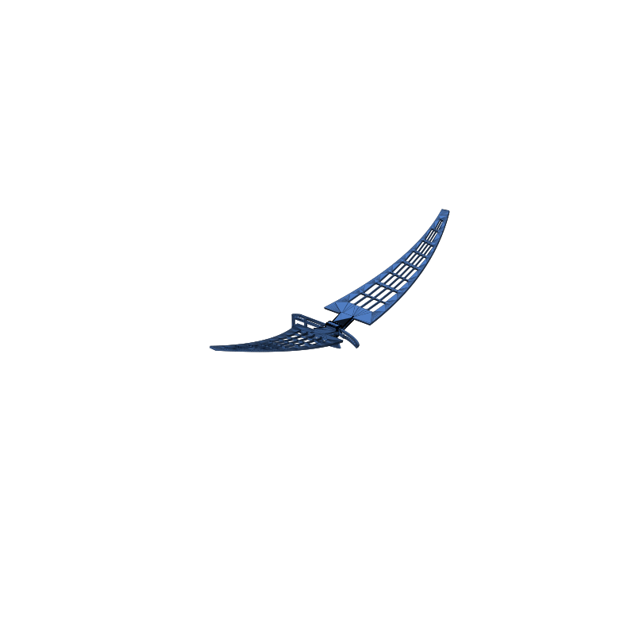
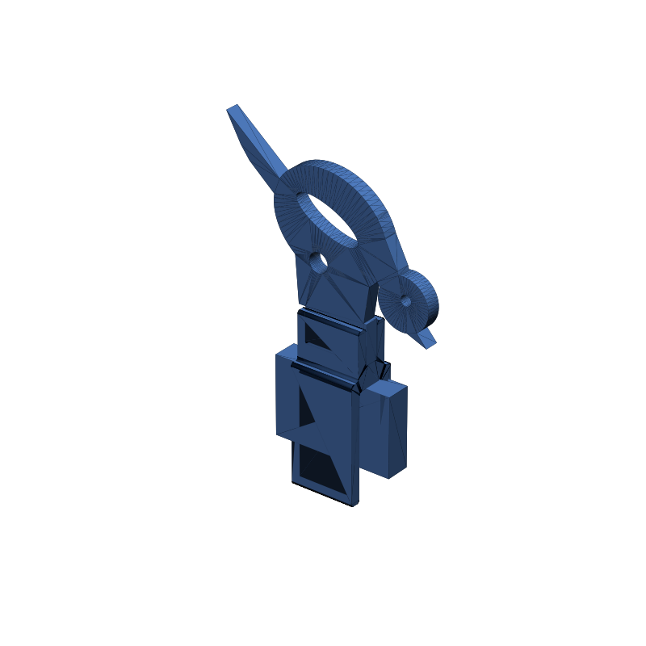
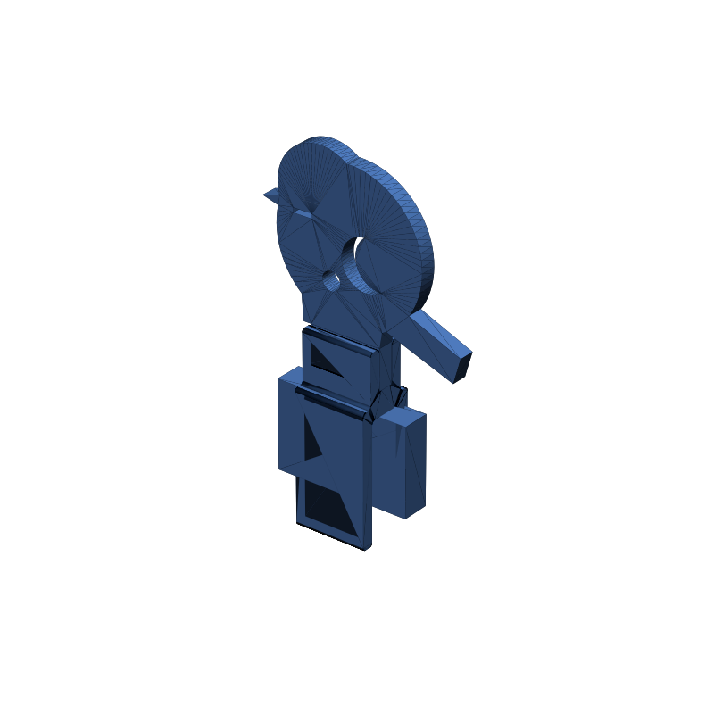
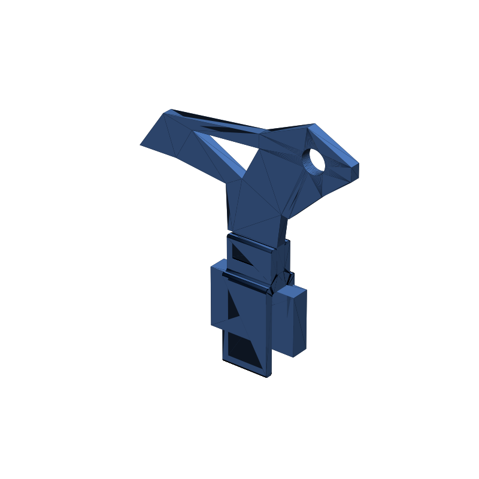
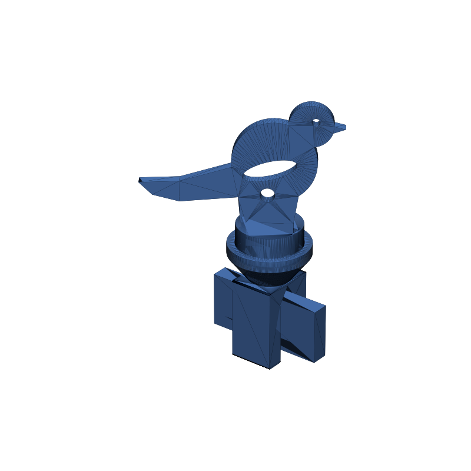
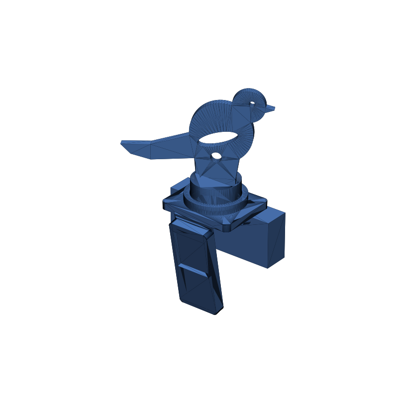

# parts-design

Parametric mechanical parts, designed as FreeCAD Python scripts. Each part lives in its own
folder under `designs/`; running its `generate.py` regenerates the model and exports
fabrication-ready outputs (STL, GLB, STEP, and a `preview.png`).

See [docs/agents-instructions.md](docs/agents-instructions.md) for repo conventions, folder
layout, and the build/validation workflow. Build a part with `make <name>` (needs FreeCAD —
run `make install-freecad` first).

## Parts

GitHub markdown can't embed an interactive glTF/GLB viewer inline, so each row shows a static
render; click the STL/GLB links in a part's own README to open GitHub's real 3D viewer.

<table>
<tr>
  <th>Preview</th>
  <th>Part</th>
  <th>Build</th>
  <th>Description</th>
</tr>
<tr>
  <td></td>
  <td><a href="designs/parametric-bird/"><b>Parametric Bird</b></a> <code>parametric-bird</code></td>
  <td><code>make parametric-bird</code></td>
  <td>Flat-plaque spread-wing bird — two grid-pattern wings that slot into one slim saddle connector riding on a flat-backed body (level or head-down "diving" version). Two master params: <code>WING_LENGTH</code> + <code>THICKNESS</code>.</td>
</tr>
<tr>
  <td></td>
  <td><a href="designs/screen-bird-perch/"><b>Screen Bird — Perch</b></a> <code>screen-bird-perch</code></td>
  <td><code>make screen-bird-perch</code></td>
  <td>Small, light bird that clips to the top of a monitor: a ~4&nbsp;mm flat side-profile plaque + a shared sprung C-clip for 5–14&nbsp;mm bezels. Perch pose — upright, alert, tail swept down as a counterweight. Two parts, no supports.</td>
</tr>
<tr>
  <td></td>
  <td><a href="designs/screen-bird-peek/"><b>Screen Bird — Peek</b></a> <code>screen-bird-peek</code></td>
  <td><code>make screen-bird-peek</code></td>
  <td>Screen-top bird, <b>peek</b> pose — body leaning forward, S-curved neck dropping the head down over the front edge, tail cocked up. Same shared C-clip + foot-tab socket as the rest of the set.</td>
</tr>
<tr>
  <td></td>
  <td><a href="designs/screen-bird-roost/"><b>Screen Bird — Roost</b></a> <code>screen-bird-roost</code></td>
  <td><code>make screen-bird-roost</code></td>
  <td>Screen-top bird, <b>roost</b> pose — a plump sleeping puffball, head tucked into the back feathers, closed-slot eye. The most compact silhouette in the set (~52&nbsp;mm), quickest print. Same shared C-clip.</td>
</tr>
<tr>
  <td></td>
  <td><a href="designs/screen-bird-abstract/"><b>Screen Bird — Abstract</b></a> <code>screen-bird-abstract</code></td>
  <td><code>make screen-bird-abstract</code></td>
  <td>Screen-top bird, <b>abstract</b> model — the whole bird is one straight-edged polygon (dart body, wedge beak, blade tail) with a round negative-space eye. Built to read as a two-tone graphic. Same shared C-clip.</td>
</tr>
<tr>
  <td></td>
  <td><a href="designs/screen-bird-clip-swivel/"><b>Screen Bird — Swivel Clip</b></a> <code>screen-bird-clip-swivel</code></td>
  <td><code>make screen-bird-clip-swivel</code></td>
  <td>Turn-to-aim mount for the screen-bird set: the C-clip gets a shallow open cup, and a thick slotted puck ("ring with a notch") just drops in and spins on a thin ring — cup wall stops it skating off, gravity holds it, set the bird's facing by hand. Prints legs-down in PLA or PETG, no supports. Any existing screen-bird-* bird fits unchanged.</td>
</tr>
<tr>
  <td></td>
  <td><a href="designs/samsung-c34-clip/"><b>Samsung C34 Clip</b></a> <code>samsung-c34-clip</code></td>
  <td><code>make samsung-c34-clip</code></td>
  <td>Saddle + counterweight tail for a thin, rounded, bezel-less monitor top edge (measured on a Samsung C34H89x — nothing to clamp). Prints as <b>one flat piece with two living hinges</b>: fold the ~50&nbsp;mm back tail down the monitor back (counterweight) and a short front flap over the front edge (backstop), and the saddle is trapped on the edge at any spot. No clamp, no adhesive, no pin. Same swivel cup + puck. Flat, cup-up, no supports.</td>
</tr>
</table>

Add a row here (preview.png, folder name, `make <name>` command, one-line description) whenever
a new design is added — see [docs/agents-instructions.md](docs/agents-instructions.md).
