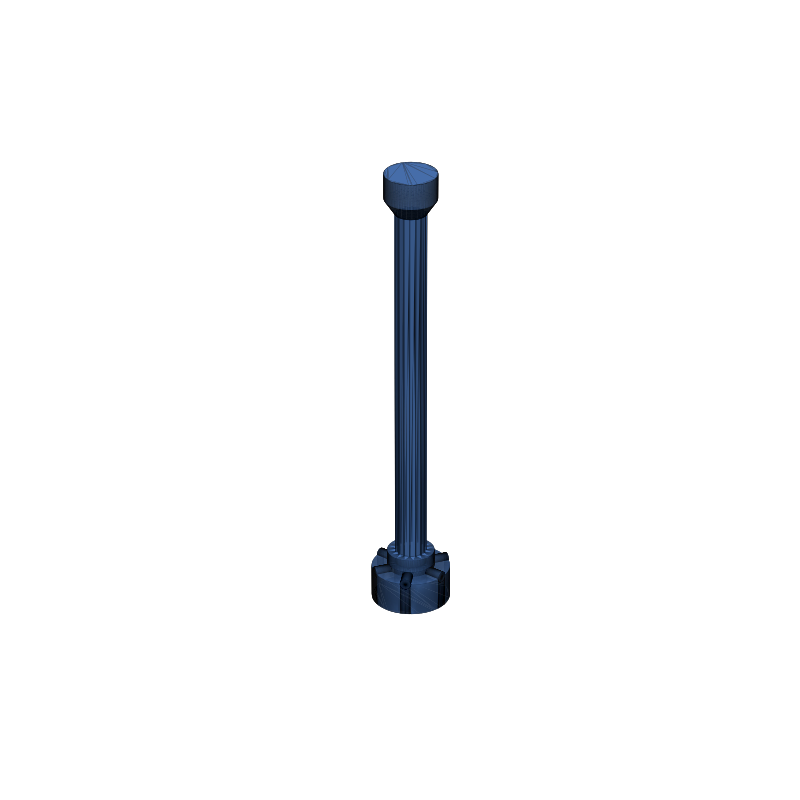

# avocado-musher

A small 2-part hand masher/muddler: a flat-bottomed disc **head** that does
the mashing, and a long **stick** (handle) that glues into it.

Parametric remake of a found reference model. The two reference STLs are
kept in [`original/`](original/) for comparison - they're a rough, non-watertight
scan/export (the two parts don't actually mesh cleanly: the head's blind
socket and the stick's base don't share consistent diameters). This
`generate.py` keeps the reference's overall scale (head ~30 mm diameter,
handle ~165 mm long) but designs its own clean joint - a blind socket bored
into the head's top hub, and a tenon + flush collar on the stick - sized so
the two printed parts actually fit together.



<a href="outputs/avocado-musher_head.stl">Download head STL</a> ·
<a href="outputs/avocado-musher_head.glb">GLB</a> ·
<a href="outputs/avocado-musher_stick.stl">Download stick STL</a> ·
<a href="outputs/avocado-musher_stick.glb">GLB</a> ·
<a href="outputs/avocado-musher_assembly.stl">Posed assembly STL</a> (preview only, not printable)

## Purpose

A small masher/muddler head on a hand-sized grip stick - mash a ripe
avocado (or muddle herbs/fruit in a glass) with the flat face, using the
knurled shaft and domed top knob for grip.

## Spec

- Head: flat, round mash face (no features on the underside - nothing to
  trap food or interrupt mashing), with a ribbed top for stiffness.
- Stick: long enough to clear a typical bowl/glass, with a grippable
  (knurled) shaft and a comfortable rounded top knob.
- The two parts join with a glue/clearance fit (not a snap or press fit) -
  tenon into a blind socket, with a flush collar carrying the joint's visual
  seam and any sideways load.
- Both parts print with **no supports** in their exported orientation.

## Parameters

All in `designs/avocado-musher/generate.py`, mm unless noted.

**Head**

| Name | Meaning | Default |
|---|---|---|
| `HEAD_DIA` | overall disc diameter | 30.0 |
| `HEAD_H` | main disc thickness (flat mash face at z=0) | 13.0 |
| `RIB_COUNT` | radiating top ribs, evenly spaced | 6 |
| `RIB_WIDTH` | rib cross-section diameter (half-round bead) | 4.0 |
| `HUB_H` | flat hub boss height above `HEAD_H` (= `RIB_WIDTH/2`, flush with the rib peaks) | 2.0 |
| `HUB_DIA` | hub boss diameter - **shared with the stick's `FLANGE_DIA`** so the collar seats flush | 18.0 |
| `BORE_DIA` | blind socket diameter (`TENON_DIA` + clearance) | 12.4 |
| `BORE_DEPTH` | blind socket depth, measured down from the hub top | 9.0 |

**Stick**

| Name | Meaning | Default |
|---|---|---|
| `SHAFT_DIA` | main grip shaft diameter | 12.0 |
| `TENON_DIA` | insertion tenon diameter (~0.4 mm radial clearance in `BORE_DIA`) | 11.6 |
| `TENON_LEN` | insertion depth (slightly less than `BORE_DEPTH` - glue pocket at the bottom) | 8.0 |
| `TENON_CHAMFER` | lead-in chamfer at the tenon tip | 1.5 |
| `FLANGE_DIA` | collar diameter (= `HUB_DIA`) | 18.0 |
| `FLANGE_H` | collar height | 5.0 |
| `SHAFT_LEN` | straight knurled grip length | 143.0 |
| `FLUTE_COUNT` / `FLUTE_WIDTH` / `FLUTE_DEPTH` | knurl grooves (`build_knurled_cylinder` in `scripts/freecad_common.py`) | 16 / 2.0 / 0.6 |
| `KNOB_TAPER_H` | cone transition from shaft to knob diameter | 6.0 |
| `KNOB_DIA` | knob diameter | 20.0 |
| `KNOB_H` | knob cylinder height before the dome fillet (= `KNOB_DIA/2`, giving a full capsule dome) | 10.0 |

## How to use

```bash
make avocado-musher
```

Builds both parts into `outputs/`. `generate.py` also prints the head/stick
interference-volume check (expect ~0 mm³ - clearance fit, not a press fit)
and each part's bounding box/volume/solid count.

## Integration / use

**BOM** - 1x `avocado-musher_head`, 1x `avocado-musher_stick`, plus:

- A dab of food-safe glue (e.g. cyanoacrylate rated for food contact, or a
  press/friction fit if printed slightly oversized) in the blind socket to
  join the tenon to the head permanently.

**Print orientation** (both parts need no supports, as exported):

- `avocado-musher_head`: flat mash face down on the bed, ribs up.
- `avocado-musher_stick`: lying on its side (a ~172 mm thin rod printed
  standing up would need a tall raft and is a tip-over risk) - `generate.py`
  exports it already rotated into this pose.

**Assembly**: push the stick's tenon into the head's blind socket until the
collar seats flush on the hub; glue if not an interference fit. The posed
`avocado-musher_assembly.*` files show this in its assembled (not printable)
form.
