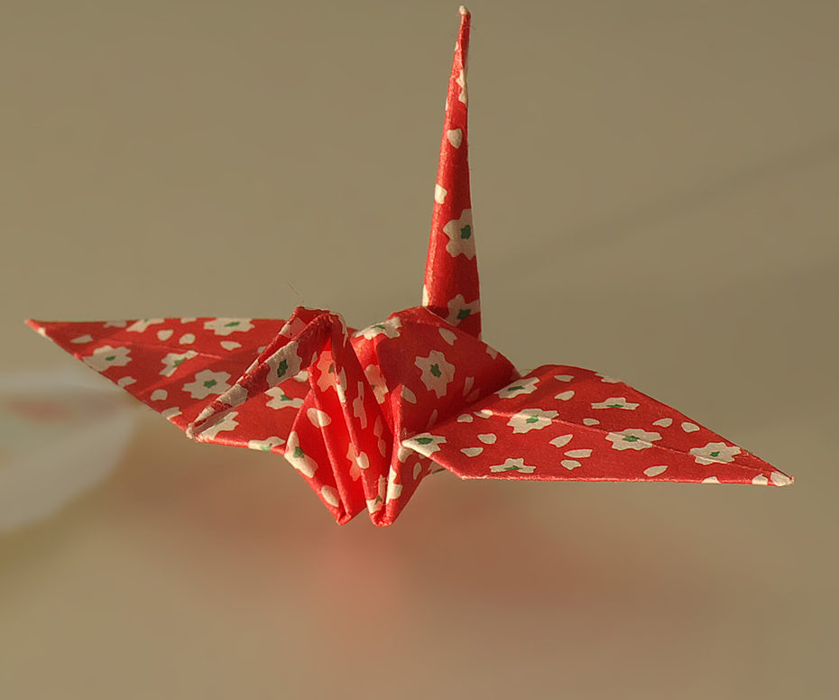
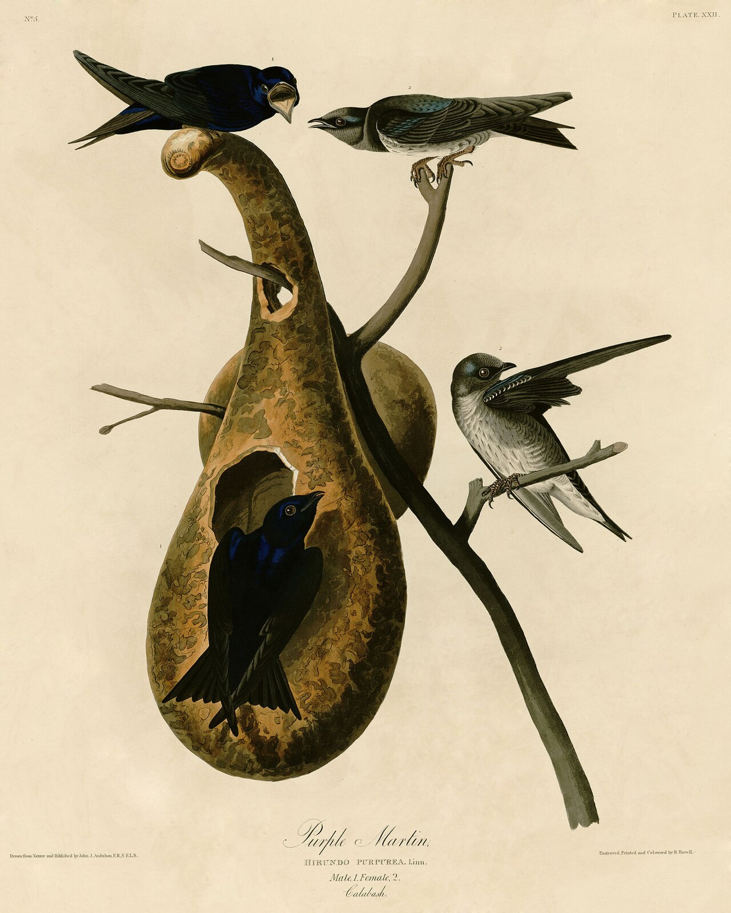

# screen-bird-abstract


*(the grey slab is a stand-in for the screen's top edge — reference only, not a printed part)*

**Part of the `screen-bird-*` set** — small, light birds that clip to the top
of a monitor, each a different pose in its own folder:
[screen-bird-perch](../screen-bird-perch/) ·
[screen-bird-peek](../screen-bird-peek/) ·
[screen-bird-roost](../screen-bird-roost/) ·
[screen-bird-abstract](../screen-bird-abstract/). For a bird you can rotate and aim, mount any of them on the turntable
[screen-bird-clip-swivel](../screen-bird-clip-swivel/) instead of its fixed clip.
All four share one mechanism — a flat side-profile bird whose belly ends in a
foot tab, plugged into a **shared flexible C-clip** (`build_screen_clip()` in
[`scripts/freecad_common.py`](../../scripts/freecad_common.py)). Only the bird
silhouette changes between folders.

## Purpose

This folder is the **abstract** model — the same idea reduced to geometry: the
whole bird is **one straight-edged polygon** (a dart body, a wedge beak, a
single blade tail) with a round negative-space eye and one angular wing slot.
No curves except the eye. It is the graphic, minimal member of the set and the
one that most obviously wants two colours.

Set-wide goals: small and light (~4 mm flat plaque, ~85 mm long, ~7.5 cm³ /
~9 g PLA for the bird); a flexible clip that grips top bezels ~**5–14 mm**
thick (more in PETG/TPU; foam pad for thinner); two parts, **no supports, no
slicer rotation**.

**Two-tone:** the body is a clean angular shape, so a single flat filament
swap by layer (front face vs back face) or a slicer colour-paint along one of
the straight edges reads as a deliberate graphic — no extra parts, one plate.
Give the clip its own colour too.

## Spec

| Piece | Qty | Notes |
|---|---|---|
| `screen-bird-abstract_bird` | 1 | flat silhouette, `BIRD_THICKNESS` = 4 mm, from the single polygon `BODY_POLY`. Cut-outs: a round eye + a triangular wing slot. A flat seat at z = 1 carries the **foot tab** (full clip width × 4 mm × 9 mm). |
| `screen-bird-abstract_clip` | 1 | the shared flexible **C-clip** — identical to every `screen-bird-*` folder. Sprung back arm + front lip with a 45°-ramped grip tooth; raised boss with a **through-slot socket** for the foot tab. Prints stood on an end face — one profile extruded along the screen-width axis, every slot a vertical channel. |

- **Bird ↔ clip fit** (absolute, does not scale): foot tab ↔ socket slot =
  `thickness + fit` 4.4 mm vs `BIRD_THICKNESS` 4.0 mm → 0.4 total clearance +
  glue. Tab is full clip width in X. Shared numbers: `SCREEN_CLIP_FOOT` /
  `SCREEN_CLIP_SEAT_Z` in `freecad_common.py`.
- **Clip grip**: relaxed mouth ≈ `BEZEL_NOMINAL − CLIP_PRELOAD` = 8.2 mm; the
  30 mm back arm flexes several mm each way.
- Every printable piece is one solid (`len(shape.Solids) == 1`, asserted).
- `screen-bird-abstract.*` / `.FCStd` are an illustrative pose only — not printable.

### Print orientation (ready to print — no supports, no rotation)

| Piece | On the bed | Overhang check |
|---|---|---|
| `..._bird` | as exported — largest face flat (z = 0), 4 mm tall | none — flat plaque; foot tab in-plane |
| `..._clip` | as exported — stood on a Y-Z end face | none — one X-extrusion; mouth, tooth, socket slot are vertical channels |

## Parameters

`generate.py`, near the top (mm):

| Name | Meaning | Default |
|---|---|---|
| `SCALE` | multiplies polygon / cut-out coordinates (not the foot tab / clip) | 0.85 |
| `BIRD_THICKNESS` | plaque + foot-tab stock; socket tracks it | `SCREEN_CLIP_FOOT["thickness"]` = 4.0 |
| `EYE_DIA` | round negative-space eye diameter | 9.0 |
| `BODY_POLY` | the entire bird outline as `(x, z)` vertices (pre-SCALE, upright frame) | see file |
| `BEZEL_NOMINAL` | bezel thickness the clip is centred on | 9.0 |
| `CLIP_PRELOAD` | relaxed-mouth undersize, for grip | 0.8 |
| `CLIP_WIDTH` | clip width along screen-width axis = foot-tab width | 18.0 |

Shared clip internals live in `build_screen_clip()` (`freecad_common.py`):
`wall` 3, `back_len` 30, `front_len` 18, `hook` 1.8, `boss_extra` 3.

## How to use

From the repo root:

```bash
make screen-bird-abstract
```

Needs FreeCAD (`make install-freecad` if missing). Standalone:

```bash
freecadcmd -c "import runpy, sys; sys.argv=['generate.py','--outdir','designs/screen-bird-abstract/outputs']; runpy.run_path('designs/screen-bird-abstract/generate.py', run_name='__main__')"
```

GUI preview: `make open-screen-bird-abstract`.

## Integration / use

1. **Print** `screen-bird-abstract_bird` ×1 and `screen-bird-abstract_clip`
   ×1 — both flat on the bed, no supports. 3+ perimeters; 15–20 % infill.
   For the two-tone look, add one filament-change layer (or paint an edge) in
   the slicer. PETG/TPU for the clip if the bezel is at the edge of the range.
2. **Bird → clip**: push the foot tab into the socket slot, centred; a drop of
   glue in the slot locks it.
3. **Clip → screen**: push it onto the top edge, sprung arm behind the panel,
   grip tooth under the bezel's front lip. Add a 1–2 mm self-adhesive foam pad
   inside the front lip for a thin bezel / to protect the coating.

### BOM

| Item | Qty | Notes |
|---|---|---|
| `screen-bird-abstract_bird` (printed) | 1 | this design |
| `screen-bird-abstract_clip` (printed) | 1 | this design — same clip across the set |
| Cyanoacrylate or plastic cement | — | one drop in the socket slot |
| Self-adhesive foam/felt pad, 1–2 mm | 0–1 | thin bezels / screen protection |

## Inspiration

Reference images are in [`inspiration/`](inspiration/); sources and licences
(all public domain) in [`inspiration/CREDITS.md`](inspiration/CREDITS.md).

 

## Outputs

<a href="outputs/screen-bird-abstract_bird.stl">screen-bird-abstract_bird.stl</a> ·
<a href="outputs/screen-bird-abstract_bird.glb">.glb</a> ·
<a href="outputs/screen-bird-abstract_bird.step">.step</a>

<a href="outputs/screen-bird-abstract_clip.stl">screen-bird-abstract_clip.stl</a> ·
<a href="outputs/screen-bird-abstract_clip.glb">.glb</a> ·
<a href="outputs/screen-bird-abstract_clip.step">.step</a>

Posed preview (not printable):
<a href="outputs/screen-bird-abstract.stl">screen-bird-abstract.stl</a> ·
<a href="outputs/screen-bird-abstract.glb">.glb</a> ·
<a href="outputs/screen-bird-abstract.FCStd">.FCStd</a>
