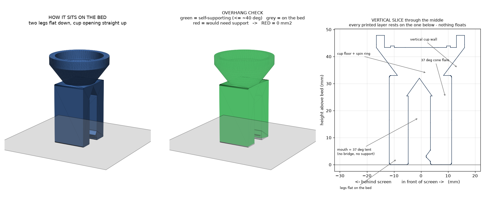

# screen-bird-clip-swivel


*(the grey slab is a stand-in for the screen's top edge — reference only, not a printed part)*

**Part of the `screen-bird-*` set** — a **turn-to-aim mount** that replaces the
fixed clip in any pose folder:
[screen-bird-perch](../screen-bird-perch/) ·
[screen-bird-peek](../screen-bird-peek/) ·
[screen-bird-roost](../screen-bird-roost/) ·
[screen-bird-abstract](../screen-bird-abstract/).
The **bird STL is unchanged** — it still ends in the same `SCREEN_CLIP_FOOT`
foot tab; only the thing under it changes.

## Purpose

The fixed clip aims the bird straight along the screen's top edge. This mount
lets you **rotate the bird to any facing and leave it there** — toward you,
toward a doorway, 30° off to catch the light, whatever.

Two printed parts instead of one:

| Piece | Qty | Notes |
|---|---|---|
| `screen-bird-clip-swivel_clip` | 1 | the same flexible C-clip that grips a monitor's top bezel (5–14 mm), but the fixed slot socket is replaced by a **shallow open cup** on a 45° cone flare above the legs. The cup is just a short vertical wall + a flat floor with a thin raised **spin ring**. No inward lip, no snap. |
| `screen-bird-clip-swivel_puck` | 1 | a plain flat-bottomed round puck — "a thick ring with a notch": just the standard `SCREEN_CLIP_FOOT` **through-slot** across the top for the bird foot tab. |

**How the turn works:** the puck simply **drops into the cup** and rests on the
thin spin ring. The cup wall stops it skating off sideways; gravity — the
bird's own weight — keeps it seated. It rides on only ~90 mm² of ring contact
(vs a ~530 mm² full disc), so it **spins with a fingertip**. Twist the bird to
any facing and let go. To remove it, lift the bird straight up.

No lip, no snap, no screw, no key. If you want it to resist being knocked off,
add a blob of removable poster putty in the cup, or drop `SCREEN_SWIVEL["seat_fit"]`
in [`scripts/freecad_common.py`](../../scripts/freecad_common.py) for a snugger
(higher-friction) fit.

## Spec

- **Bird ↔ puck**: identical to the fixed clip — foot tab (full width × 4 mm ×
  9 mm) into the puck's through-slot (`thickness + fit` = 4.4 mm), + a drop of
  glue. Any already-printed `screen-bird-*` bird fits.
- **Puck ↔ cup**: puck OD `SCREEN_SWIVEL["puck_od"]` = 26 mm in a cup bore
  `puck_od + seat_fit` = 26.7 mm → 0.35 mm radial clearance per side. Verified
  in `generate.py`'s build: the puck↔clip overlap is **0 mm³ at every rotation
  angle** — it turns completely free and is held only by gravity.
- **Clip grip**: relaxed mouth ≈ `BEZEL_NOMINAL − CLIP_PRELOAD` = 8.2 mm.
  The swivel clip uses **equal-length legs** (`back_len` = `front_len` = 26)
  so both sit flat on the bed in the print orientation.
- Both printable pieces are one solid (`len(shape.Solids) == 1`, asserted).
- `screen-bird-clip-swivel.*` / `.FCStd` are a posed preview (clip + puck +
  a demo perch bird turned 35° off-axis, on a grey screen-edge slab) — not a
  printable body.

### Print orientation — legs-down, no supports, PLA or PETG



Both parts are modelled **in the use orientation** and export tucked to the
bed with no rotation. Set them on the plate as-is and slice — no supports.

**`..._clip`** — sits on its **two leg feet**, cup opening straight up. Walk it
bottom to top (see the slice, right-hand panel above):

1. the two legs are plain rectangular towers straight off the bed;
2. across the mouth between them, the ceiling is a **~37° tent** — the legs
   climb toward each other and meet at a ridge, so there is no bridge and no
   support across the gap;
3. the step out to the wider cup is a **~37° cone flare** — round, so there
   are no corners that would exceed 45°, and its base is sized to sit fully
   within the leg footprint (nothing hangs over the leg tops);
4. the **cup wall is a plain vertical ring**; a round bore is just a vertical
   hole — "roundness" never needs support;
5. the cup floor and the little raised **spin ring** face straight up.

An overhang scan of the exported STL: **0 mm² would need support** (every
downward-facing surface is ≤ ~40° from vertical or sits on the bed).

**`..._puck`** — sits flat, slot up. A plain disc with a slot open at both
ends. Overhang scan: **0 mm²**.

Print the **clip in PETG or a tough PLA** — its back arm still flexes to grip,
and in this orientation the arm's layers run across the bend.

## Parameters

`generate.py`, near the top (mm / degrees):

| Name | Meaning | Default |
|---|---|---|
| `BIRD_THICKNESS` | must match the birds; the puck slot tracks it | `SCREEN_CLIP_FOOT["thickness"]` = 4.0 |
| `BEZEL_NOMINAL` | bezel thickness the clip is centred on | 9.0 |
| `CLIP_PRELOAD` | relaxed-mouth undersize, for grip | 0.8 |
| `CLIP_WIDTH` | clip width along screen-width axis = puck slot width | 18.0 |
| `CLIP_WALL` | clip / cup wall thickness (thicker than the fixed clip — it carries the cup) | 5.0 |

Cup / puck geometry in `SCREEN_SWIVEL` (`freecad_common.py`): `puck_od` 26.0,
`puck_h` 12.0, **`seat_fit` 0.7** (cup radial clearance — lower for a snugger,
higher-friction turn), `cup_wall` 3.0, `cup_h` 4.5, `spin_ring_w` 1.4,
`spin_ring_h` 0.6.

## How to use

From the repo root:

```bash
make screen-bird-clip-swivel
```

Needs FreeCAD (`make install-freecad` if missing). Standalone:

```bash
freecadcmd -c "import runpy, sys; sys.argv=['generate.py','--outdir','designs/screen-bird-clip-swivel/outputs']; runpy.run_path('designs/screen-bird-clip-swivel/generate.py', run_name='__main__')"
```

GUI preview: `make open-screen-bird-clip-swivel`.

## Integration / use

1. **Print** `..._clip` ×1 and `..._puck` ×1 (PETG / tough PLA for the clip).
   No supports. You do **not** reprint the bird.
2. **Bird → puck**: push the bird's foot tab into the puck's top slot, centred;
   a drop of glue locks it. (Do this off the clip.)
3. **Puck → cup**: just drop the puck (with the bird glued in) into the cup.
   It rests on the spin ring; nothing to click.
4. **Clip → screen**: push the clip onto the monitor's top edge, sprung arm
   behind the panel, grip tooth under the bezel's front lip. Foam pad inside
   the front lip for a thin bezel / to protect the coating.
5. **Aim**: twist the bird to the facing you want; let go. Gravity holds it.
   If a knock could dislodge it, add poster putty in the cup; if it turns too
   freely for you, drop `SCREEN_SWIVEL["seat_fit"]` and reprint the puck.

### BOM

| Item | Qty | Notes |
|---|---|---|
| `screen-bird-clip-swivel_clip` (printed) | 1 | this design |
| `screen-bird-clip-swivel_puck` (printed) | 1 | this design |
| any `screen-bird-*` bird (printed) | 1 | unchanged — perch / peek / roost / abstract |
| Cyanoacrylate or plastic cement | — | one drop in the puck slot |
| Self-adhesive foam/felt pad, 1–2 mm | 0–1 | thin bezels / screen protection |

## Outputs

<a href="outputs/screen-bird-clip-swivel_clip.stl">screen-bird-clip-swivel_clip.stl</a> ·
<a href="outputs/screen-bird-clip-swivel_clip.glb">.glb</a> ·
<a href="outputs/screen-bird-clip-swivel_clip.step">.step</a>

<a href="outputs/screen-bird-clip-swivel_puck.stl">screen-bird-clip-swivel_puck.stl</a> ·
<a href="outputs/screen-bird-clip-swivel_puck.glb">.glb</a> ·
<a href="outputs/screen-bird-clip-swivel_puck.step">.step</a>

Posed preview (not printable):
<a href="outputs/screen-bird-clip-swivel.stl">screen-bird-clip-swivel.stl</a> ·
<a href="outputs/screen-bird-clip-swivel.glb">.glb</a> ·
<a href="outputs/screen-bird-clip-swivel.FCStd">.FCStd</a>
