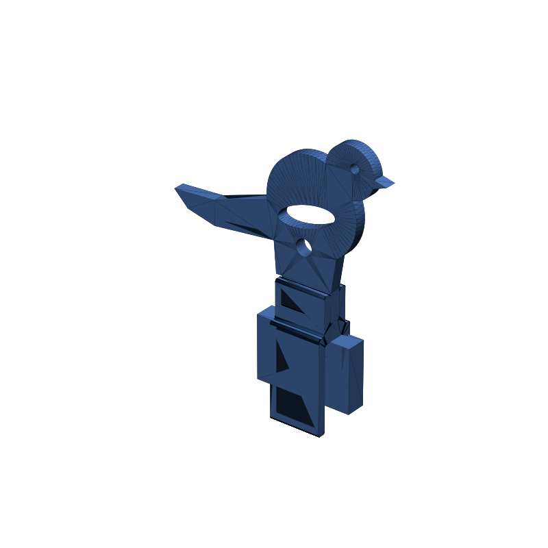
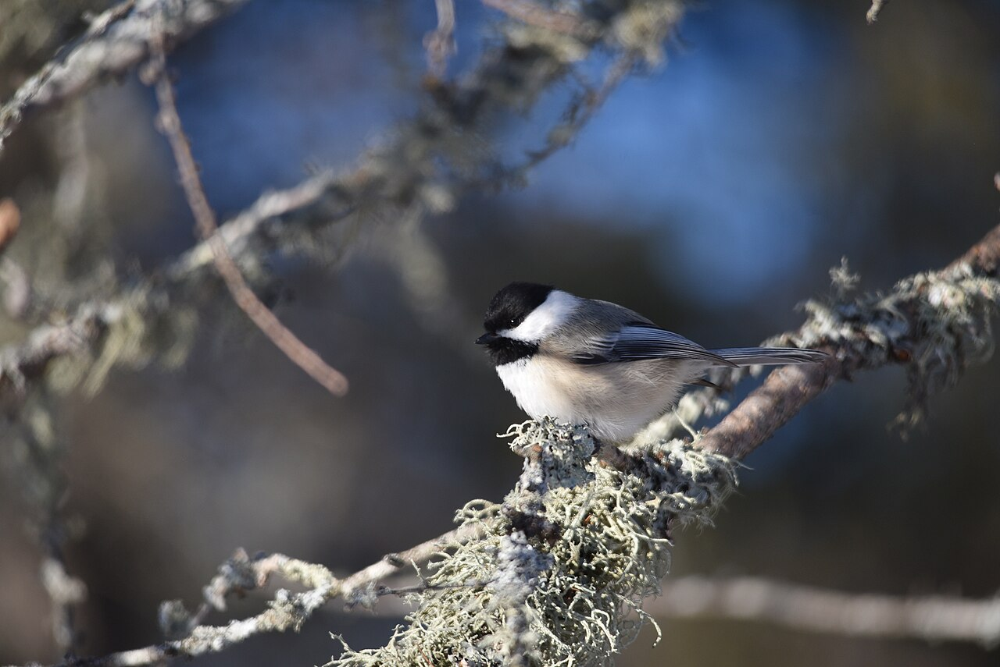
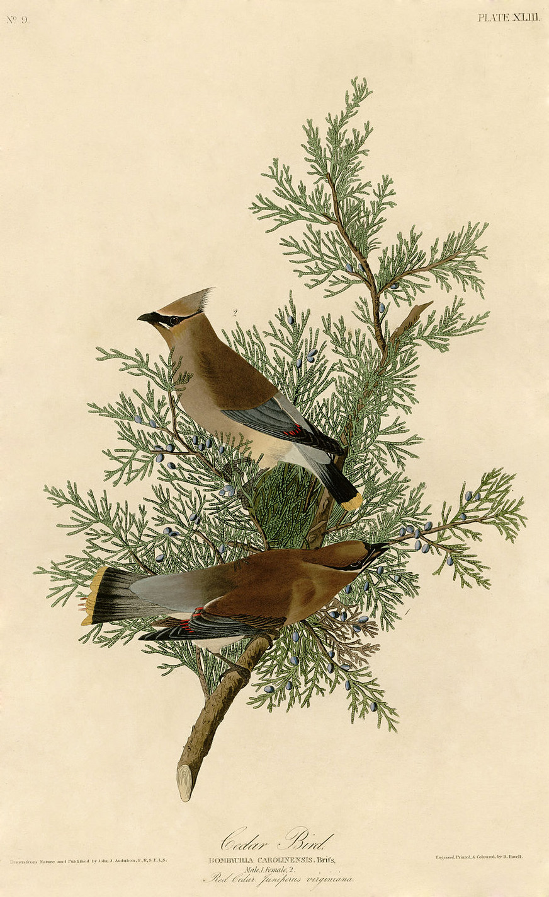

# screen-bird-perch



*(the grey slab is a stand-in for the screen's top edge — reference only, not a printed part)*

**Part of the `screen-bird-*` set** — small, light birds that clip to the top
of a monitor, each a different pose in its own folder:
[screen-bird-perch](../screen-bird-perch/) ·
[screen-bird-peek](../screen-bird-peek/) ·
[screen-bird-roost](../screen-bird-roost/) ·
[screen-bird-abstract](../screen-bird-abstract/). For a bird you can rotate and aim, mount any of them on the turntable
[screen-bird-clip-swivel](../screen-bird-clip-swivel/) instead of its fixed clip.
All four share one mechanism — a flat side-profile bird whose belly ends in a
foot tab, plugged into a **shared flexible C-clip** (`build_screen_clip()` in
[`scripts/freecad_common.py`](../../scripts/freecad_common.py)). Only the bird
silhouette changes between folders.

## Purpose

A desk ornament: a little bird perched on the top bezel of a stationary
monitor. This folder is the **perch** pose — an upright, alert songbird, chest
up, head high and slightly forward, with a long tail swept down and back so
the bird's mass sits over the clip rather than cantilevered off the front.

Design goals for the whole set:

- **Small and light** — a ~4 mm flat plaque, ~75 mm long, pierced with a wing
  cut-out and a vent. ~6.4 cm³ of plastic (~8 g PLA) for the bird.
- **Different poses** — perch / peek / roost / abstract, one per folder.
- **Fits many screens** — the clip is a sprung C that grips top bezels from
  roughly **5–14 mm** thick (more in PETG/TPU; a stick-on foam pad extends the
  thin end and protects the screen).
- **Fast, cheap, few parts** — two parts, both flat-ish, **no supports, no
  slicer rotation**. Print in one colour, or give the bird and clip different
  filaments (they are separate objects) and/or paint the beak / eye / wing
  edge in the slicer — no extra parts, one plate.

## Spec

| Piece | Qty | Notes |
|---|---|---|
| `screen-bird-perch_bird` | 1 | flat side profile, `BIRD_THICKNESS` = 4 mm stock. Swept wing cut-out + a round vent for weight; drilled eye. Lower breast tapers to a flat seat at z = 1 that carries a **foot tab** (full clip width × 4 mm × 9 mm) at the belly. |
| `screen-bird-perch_clip` | 1 | the shared flexible **C-clip**. A sprung back arm + a front lip with a 45°-ramped grip tooth grab the bezel; a raised boss on the back carries a **through-slot socket** the foot tab drops into. One profile extruded along the screen-width axis — prints stood on an end face, every slot a vertical channel. |

- **Bird ↔ clip fit** (absolute, does **not** scale with the bird):

  | joint | slot | plaque | clearance |
  |---|---|---|---|
  | foot tab ↔ socket slot | `thickness + fit` = 4.4 mm (Y) | `BIRD_THICKNESS` = 4.0 mm | 0.4 total (0.2/face) + a dab of glue |

  The tab is the **full clip width** in X, so the slot captures it in Y and Z
  and you only centre it in X. Shared numbers live in `SCREEN_CLIP_FOOT` /
  `SCREEN_CLIP_SEAT_Z` in `freecad_common.py` — imported here, never re-typed.
- **Clip grip**: relaxed mouth ≈ `BEZEL_NOMINAL − CLIP_PRELOAD` = 8.2 mm; the
  30 mm back arm flexes several mm each way. Drop `CLIP_PRELOAD` toward 0 for a
  looser clip, raise it for more bite.
- Every printable piece is one connected solid (asserted in `generate.py`:
  `len(shape.Solids) == 1`).
- `screen-bird-perch.*` / `.FCStd` are an **illustrative pose only** (bird +
  clip + a grey screen-edge slab) — not a printable body.

### Print orientation (all exported ready to print — no supports, no rotation)

| Piece | On the bed | Overhang check |
|---|---|---|
| `..._bird` | as exported — largest face flat (z = 0), 4 mm tall | none — flat plaque; foot tab is in-plane |
| `..._clip` | as exported — `generate.py` stands it on a Y-Z end face so the extrusion axis is vertical | none — the whole part is one profile pulled along X, so the mouth, grip tooth and socket slot are all vertical channels |

## Parameters

All in `generate.py` near the top (mm / degrees).

| Name | Meaning | Default |
|---|---|---|
| `SCALE` | multiplies every silhouette length (not the foot tab or clip, which are absolute) | 0.85 |
| `BIRD_THICKNESS` | plaque + foot-tab stock; the socket slot tracks it | `SCREEN_CLIP_FOOT["thickness"]` = 4.0 |
| `EYE_DIA` | eye hole diameter | 3.2 |
| `LIGHTEN` | list of `(cx, cz, a, b, angle°)` rotated-ellipse cut-outs (pre-SCALE) — wing sweep + vent | see file |
| `BEZEL_NOMINAL` | screen-bezel thickness the clip is centred on | 9.0 |
| `CLIP_PRELOAD` | how much the relaxed mouth is undersized, for grip | 0.8 |
| `CLIP_WIDTH` | clip extent along the screen-width axis = foot-tab width | 18.0 |

Shared clip internals (`build_screen_clip()` in `freecad_common.py`): `wall`
3, `back_len` 30, `front_len` 18, `hook` 1.8, `boss_wall` 3, `boss_extra` 3,
`fillet` 0.8. `SCREEN_CLIP_SEAT_Z` (6.0) is where the tab tip lands; a change
to `wall` / `boss_extra` that would move it trips a warning.

## How to use

From the repo root:

```bash
make screen-bird-perch
```

Needs FreeCAD (`make install-freecad` if `freecadcmd` isn't found). Standalone
(see `docs/agents-instructions.md` for the `runpy` wrapper):

```bash
freecadcmd -c "import runpy, sys; sys.argv=['generate.py','--outdir','designs/screen-bird-perch/outputs']; runpy.run_path('designs/screen-bird-perch/generate.py', run_name='__main__')"
```

Open the posed preview in the FreeCAD GUI:

```bash
make open-screen-bird-perch
```

## Integration / use

1. **Print** `screen-bird-perch_bird` ×1 and `screen-bird-perch_clip` ×1.
   Both drop straight on the bed — no supports, no rotation. 3+ perimeters so
   the thin webs by the wing cut-out come out solid; 15–20 % infill is plenty.
   PLA works; **PETG or TPU** for the clip if your bezel is at the edge of the
   range or you'll re-seat it often.
2. **Fit the bird to the clip**: push the foot tab down into the clip's
   socket slot, centred along the slot. Friction holds it for trial fitting; a
   drop of glue (cyanoacrylate or plastic cement) in the slot locks it.
3. **Clip to the screen**: push the clip down onto the monitor's top edge so
   the sprung arm is behind the panel and the grip tooth catches under the
   front lip of the bezel. For a thin bezel, stick a 1–2 mm self-adhesive
   foam/felt pad inside the front lip — it takes up slack and protects the
   screen coating.
4. Tune `BEZEL_NOMINAL` to your measured bezel and re-run if the default
   doesn't grip well.

### BOM

| Item | Qty | Notes |
|---|---|---|
| `screen-bird-perch_bird` (printed) | 1 | this design |
| `screen-bird-perch_clip` (printed) | 1 | this design — same clip as every `screen-bird-*` folder |
| Cyanoacrylate or plastic cement | — | one drop in the socket slot |
| Self-adhesive foam/felt pad, 1–2 mm | 0–1 | for thin bezels / screen protection |

## Inspiration

Reference photos and plates that informed the pose are in
[`inspiration/`](inspiration/) with sources and licences in
[`inspiration/CREDITS.md`](inspiration/CREDITS.md) (all public domain).

 

## Outputs

<a href="outputs/screen-bird-perch_bird.stl">screen-bird-perch_bird.stl</a> ·
<a href="outputs/screen-bird-perch_bird.glb">.glb</a> ·
<a href="outputs/screen-bird-perch_bird.step">.step</a>

<a href="outputs/screen-bird-perch_clip.stl">screen-bird-perch_clip.stl</a> ·
<a href="outputs/screen-bird-perch_clip.glb">.glb</a> ·
<a href="outputs/screen-bird-perch_clip.step">.step</a>

Posed preview (not printable):
<a href="outputs/screen-bird-perch.stl">screen-bird-perch.stl</a> ·
<a href="outputs/screen-bird-perch.glb">.glb</a> ·
<a href="outputs/screen-bird-perch.FCStd">.FCStd</a>
